# Product Search Service: load testing, horizontal scaling and auto scaling on ECS Fargate

A Go + Gin product service with a fixed-cost search endpoint, deployed to one small ECS Fargate task with Terraform. It's load tested with Locust and observed two ways at once: the Homework 5 Prometheus/Grafana dashboard and CloudWatch.

| Method | Path | Notes |
|---|---|---|
| `GET` | `/products/search?q={query}` | **New.** Case-insensitive match on name or category, checks exactly 100 products, returns ≤ 20 |
| `GET` | `/products/{productId}` | From Homework 5 |
| `POST` | `/products/{productId}/details` | From Homework 5 |
| `GET` | `/metrics` | Prometheus metrics |

**Contents:** [Part II report](#report) · [Part III: horizontal scaling](#part-iii-horizontal-scaling-with-auto-scaling) · [Where everything is](#where-everything-is) · [Deploy](#deploy) · [Search requests](#search-requests) · [Run the load tests](#run-the-load-tests) · [Observability](#observability) · [Clean up](#clean-up) · [Troubleshooting](#troubleshooting)

---

## Report

*Part II: one task, finding the breaking point.*

### Setup

| | |
|---|---|
| Service | ECS Fargate, **256 CPU units (0.25 vCPU), 512 MB, 1 task**, us-west-2 |
| Data | 100,000 products generated at startup: name `Product <Brand> <ID>`, category rotated by modulo through 10 names |
| Work per request | Exactly **100 products checked** per search (a rotating window over the catalog), single-threaded, ≤ 20 results returned |
| Load | Locust `FastHttpUser`, 12 common terms (`electronics`, `books`, `alpha`, `product`, …), 0–10 ms wait |
| Load generator | EC2 `t3.medium` in us-west-2, hitting the task's private IP (first attempt: laptop, see [Creative stress testing](#5-creative-stress-testing)) |
| Observability | HW5 Grafana dashboard (Prometheus scrapes the task's `/metrics` every 5 s) **and** CloudWatch `AWS/ECS` service metrics, plus CloudWatch Logs |

**Verification with single searches** (from the EC2 instance, [`results/data/verification_single_search.txt`](results/data/verification_single_search.txt)): ~1.5 ms end to end, ~0.1 ms inside the handler (well under the 20 ms target). Four searches raised `search_products_checked_total` by exactly 400. One user alone already drives the task to ~23% CPU.

### Results

| Test | Users | Duration | Requests | Failures | req/s | p50 | p95 | p99 | CloudWatch CPU (avg) | CloudWatch memory |
|---|---|---|---|---|---|---|---|---|---|---|
| 1: baseline | 5 | 2 min | 85,370 | 0 | 712 | 1 ms | 1 ms | 5 ms | **~77%** | 10.6% (flat) |
| 2: breaking point | 20 | 3 min | 191,421 | 0 | 1,065 | 1 ms | **66 ms** | **87 ms** | **~97–99%** | 10.8% (flat) |
| 3: step load | 1 → 40 | 3.5 min | 144,567 | 0 | 688 | 1 ms | 75 ms | 89 ms | 23% → 100% | flat |

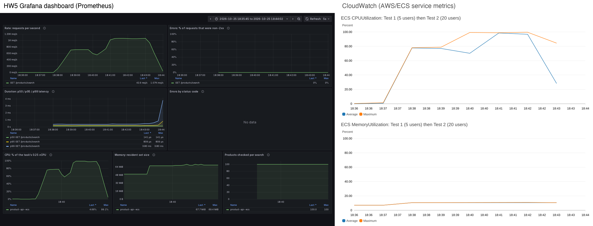

### 1. What happened when load increased

- **5 users: moderate CPU, fast responses.** 712 req/s at ~77% CPU, p99 5 ms.
- **20 users: CPU saturated, responses degraded.** 4× the users gave only **1.5× the throughput** (1,065 req/s). CPU sat at 97–99%, and p90/p95/p99 jumped to 62/66/87 ms. Nothing failed; requests got slower.
- **The step test shows where it breaks** ([`test3_step_by_step.csv`](results/data/ec2/test3_step_by_step.csv)):

  | Users | 1 | 2 | 3 | 5 | 10 | 20 | 40 |
  |---|---|---|---|---|---|---|---|
  | req/s | 145 | 296 | 423 | 721 | 892 | 1,069 | 1,151 |
  | CPU | 23% | 38% | 53% | 77% | 95% | 99% | 100% |
  | p95 | 1 ms | 1 ms | 1 ms | 1 ms | 2 ms | 30 ms | 70 ms |

  Throughput grows linearly (~145 req/s per user) until about 5–10 users. After that it flattens at **~1,100–1,150 req/s**, and every extra user only adds latency: going from 20 to 40 users bought 8% more throughput and 2.3× the p95.
- **Why the latency jumps to ~65 ms specifically:** a 0.25 vCPU task gets 25 ms of CPU per 100 ms. Once that's used, Fargate pauses the whole process for the rest of the period. The request logs show it directly: at ~1,000 req/s, consecutive log lines have **~65 ms gaps with nothing in between** ([`request_logs.md`](results/data/request_logs.md)).
- **Memory didn't move:** 10.5–10.8% of 512 MB (~68 MiB RSS) throughout, because all products are loaded at startup.

### 2. Optimization or scaling? The evidence

| Evidence | Where it came from | What it says |
|---|---|---|
| Work per request is constant: products checked/search = **100** in every test | Grafana panel from `search_products_checked_total` | The code isn't doing more work under load |
| Time *inside* the handler is unchanged: p50 0.107 → 0.110 ms, p99 0.26 → 0.39 ms from 5 to 20 users | CloudWatch Logs Insights over every request | The search didn't get slower |
| Client p95 rose 1 → 66 ms while the handler stayed < 0.4 ms | Locust vs. Prometheus/Logs | The extra time is *waiting for CPU*, not computing |
| CPU pinned at 99–100% while throughput plateaus at ~1,100 req/s | CloudWatch CPUUtilization + step test | The task is out of CPU |
| Memory flat at ~10% | CloudWatch MemoryUtilization | Not a memory problem |
| CPU cost per request is roughly constant (~0.09% CPU per req/s at load) | CPU ÷ req/s per step | Capacity scales with CPU, so adding CPU adds throughput |

**Verdict: scaling.** The algorithm is fixed by design (100 checks per search, as with model inference or video frames), and per-request cost doesn't degrade with load. Optimizing constant overhead (JSON encoding, `ToLower` allocations) could raise the ceiling somewhat, but demand grows linearly at ~145 req/s per user, so any fixed ceiling gets hit again. The fix is more CPU: more tasks (horizontal) or a bigger task (vertical).

### 3. Using CloudWatch metrics to make scaling decisions

- **Capacity per task** (from CloudWatch CPU against measured throughput): **~1,100 req/s at 100% CPU**, so ~770 req/s at a 70% target.
- **Demand:** unthrottled, each user sends ~145 req/s. Test 2's 20 users want **~2,900 req/s**.
- **Tasks needed** = demand ÷ capacity at target = 2,900 ÷ 770 ≈ **4 tasks** at 70% CPU (3 would run at ~88%).
- **The trigger:** I created a CloudWatch alarm on the service, `CS6650-search-cpu-high` (average `CPUUtilization` > 70% for one 1-minute period). During the step test it **went into ALARM** on the 18:48 datapoint (96% average, the 10–20 user steps). This is the signal ECS Service Auto Scaling (target tracking on `ECSServiceAverageCPUUtilization` = 70%) uses to add tasks.
- **Reaction time matters:** the alarm fired at 18:51:53, about 4 minutes after CPU crossed 70%, because ECS metrics are 1-minute averages published with a delay. For spiky traffic, scale out at a lower threshold or keep spare capacity rather than relying on the alarm alone.

  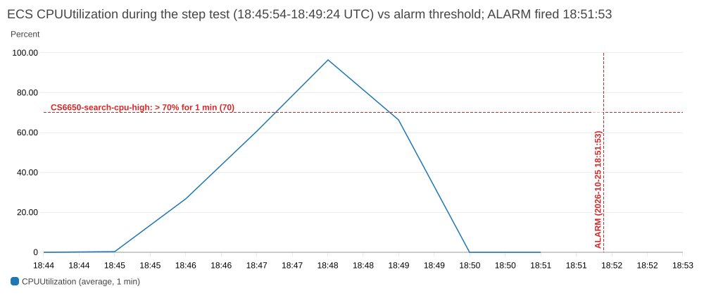

- **Don't scale on memory:** it stays at ~10%, so memory isn't a useful scaling signal for this service.
- **Caveat:** each task here has its own public IP, so adding tasks only helps once a load balancer spreads traffic across them. That's the next step for horizontal scaling.

### 4. HW5 dashboard vs. CloudWatch, side by side

Same Test 2 window (20 users). Grafana is on the left, CloudWatch on the right:


| | HW5 Grafana dashboard (Prometheus) | CloudWatch |
|---|---|---|
| **What it showed that the other didn't** | Request rate, error %, **latency percentiles inside the handler**, errors by status, **products checked per search**. This is the app's own view: the search stayed at ~0.1 ms and always checked 100 products. | **CPU and memory relative to the task's Fargate reservation** (0.25 vCPU, 512 MB), measured by the platform rather than my code. Memory at 10% of the limit (Grafana only shows 68 MiB RSS, not how close that is to 512 MB). **Alarms** that can drive auto scaling, and **Logs Insights** over every request. Works without me running anything. |
| Resolution | 5 s: each 30-second step of the step test shows up as its own level | 1 min: the steps blur into one ramp, and data arrives 2–4 min late |
| Blind spots | No idea of the task's limits or the platform. If the laptop running Prometheus is off, nothing is recorded. | No request rate or latency for this service (no load balancer). Can't see *why* CPU is high. |

**Together:** CloudWatch says *the task is out of CPU*; Grafana says *the code isn't any slower, requests are just waiting*. That combination points to scaling rather than optimization. They also cross-check each other: my Grafana CPU panel (from `process_cpu_seconds_total`) reads 77% / 99% for Tests 1 and 2, matching CloudWatch's 77.6% / 98.6%.

<details>
<summary>Test 1 and step test side by side, and the Locust reports</summary>

**Test 1 (5 users)**
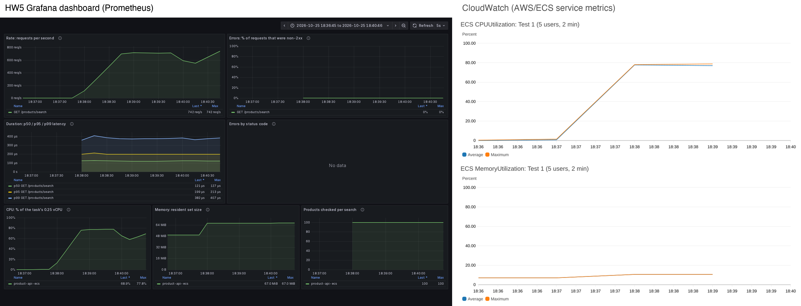

**Test 3, step load (1 → 40 users)**
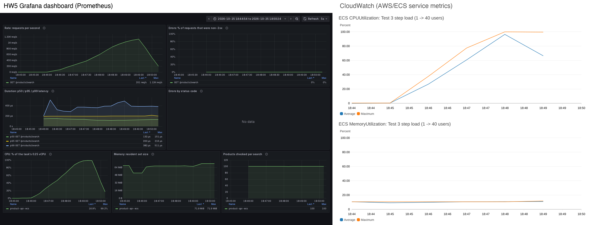

**Locust reports**
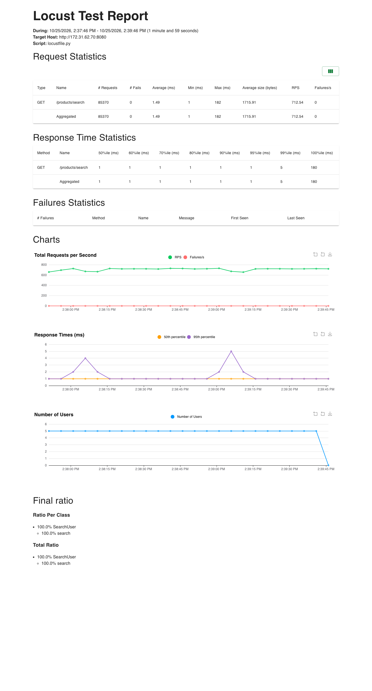
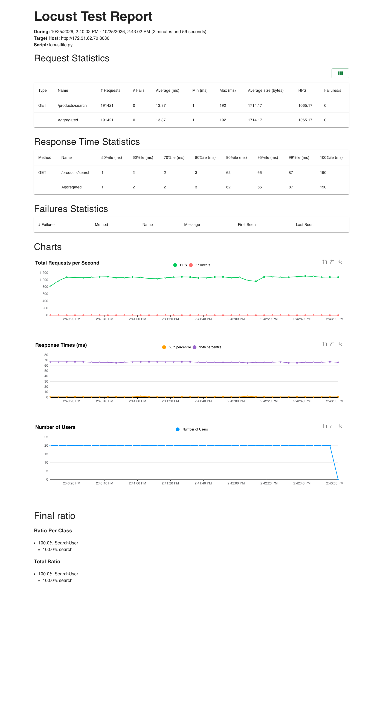
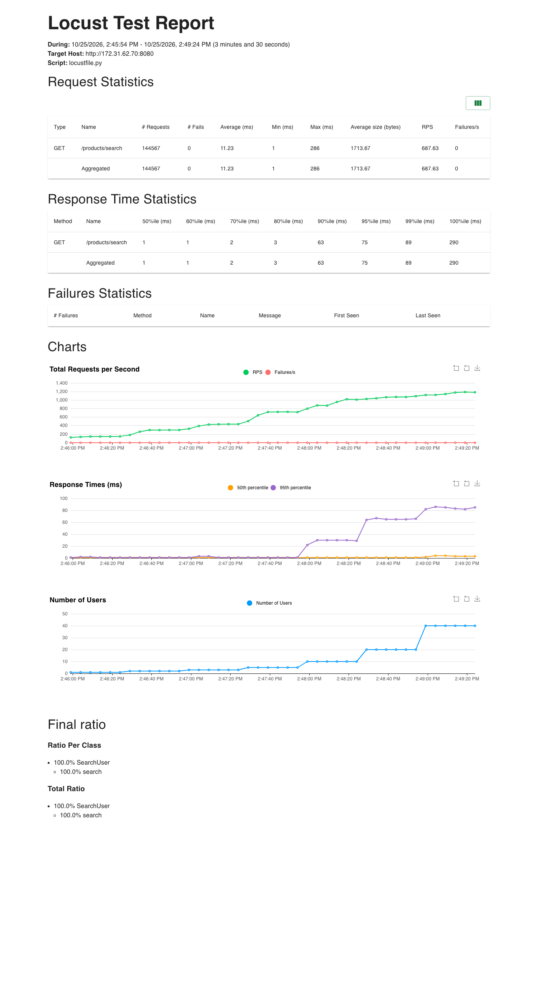

</details>

### 5. Creative stress testing

1. **Same test from two places, to separate client limits from server limits.** The first run was from my laptop. It reached only 43 / 162 req/s at 5 / 20 users, with CPU at 3–7% / 17%. That looks exactly like the handout's *"CPU under 40% with 20 users: checking too few products"*. But the products-checked metric proved 100 per search, and latency was flat at ~110 ms (the laptop → us-west-2 round trip) at both loads. **The load generator was the bottleneck, not the server.** Moving Locust to EC2 in the same region gave 17× the throughput at 5 users and exposed the real CPU limit.

   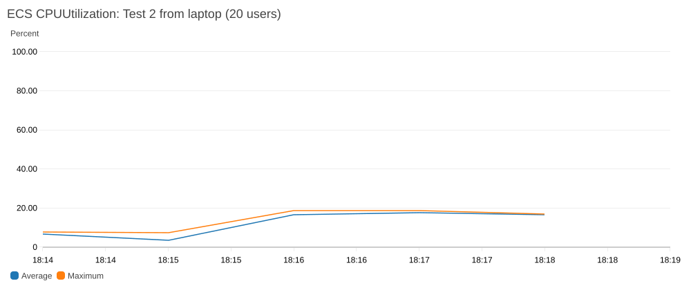

2. **Step-load shape** (`locust/step_locustfile.py`): 1 → 2 → 3 → 5 → 10 → 20 → 40 users, 30 s each, to find the knee instead of guessing at two points.
3. **A correctness probe built into the service:** `search_products_checked_total`, graphed as products checked per search, rules out "checking too many/too few products" while the test runs.
4. **Log forensics:** Logs Insights percentiles of in-handler time per test, and finding the ~65 ms CPU-throttling gaps in the raw log timeline.
5. **An automated scaling trigger** (the CloudWatch alarm) exercised by real load, not just designed on paper.

### Data

Everything behind the numbers above is in [`results/data/`](results/data):

| File | Contents |
|---|---|
| `ec2/test*_stats.csv`, `ec2/test*_stats_history.csv`, `ec2/test*_locust_report.html`, `ec2/test*_summary.txt` | Locust output for Tests 1–3, with start/end times (UTC) |
| `ec2/test3_step_by_step.csv` | Per-step req/s, latency, CPU, handler p99 |
| `prometheus_timeseries.csv` | 5 s series for all three tests: CPU, RSS, req/s, handler p50/p99, products checked per search |
| `cloudwatch_datapoints.csv` | CloudWatch 1 min CPU and memory (average, maximum) |
| `request_logs.md` | Logs Insights results, CPU-throttling gaps, slow-request lines |
| `verification_single_search.txt` | Single-search checks before load testing |
| `laptop/` | The first (laptop) runs |

---

## Part III: Horizontal scaling with auto scaling

### Setup

Same service and search logic (100,000 products, 100 checked per search). The only code change is `GET /health` for the load balancer.

| | |
|---|---|
| Load balancer | ALB on port 80 → target group: **target type IP**, HTTP **8080**, health check **`/health` every 30 s, healthy after 2 passes**, 30 s deregistration delay |
| Auto scaling | Target tracking on **average service CPU = 70%**, **min 2, max 4** tasks, **300 s** scale-out and scale-in cooldowns |
| Tasks | Same Fargate size as Part II: 0.25 vCPU, 512 MB |
| Load | **The Part II breaking-point test (20 users, `search_locustfile.py`)** from EC2 in us-west-2, against the ALB DNS name, held for 20 min so scaling has time to happen |
| Monitoring | CloudWatch dashboard `CS6650-search-scaling` (infra: per-task CPU, desired/running tasks, healthy targets, ALB requests/latency/errors) **and** the HW5 Grafana dashboard scraping every task, side by side |

### Core test: the load that broke Part II

**2,116,975 requests, 0 failures** over 20 minutes, including three task failures I caused during the run.

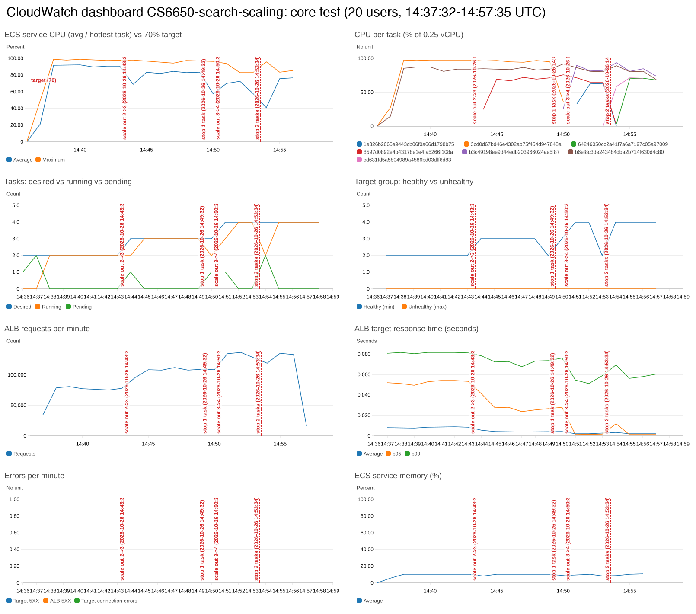

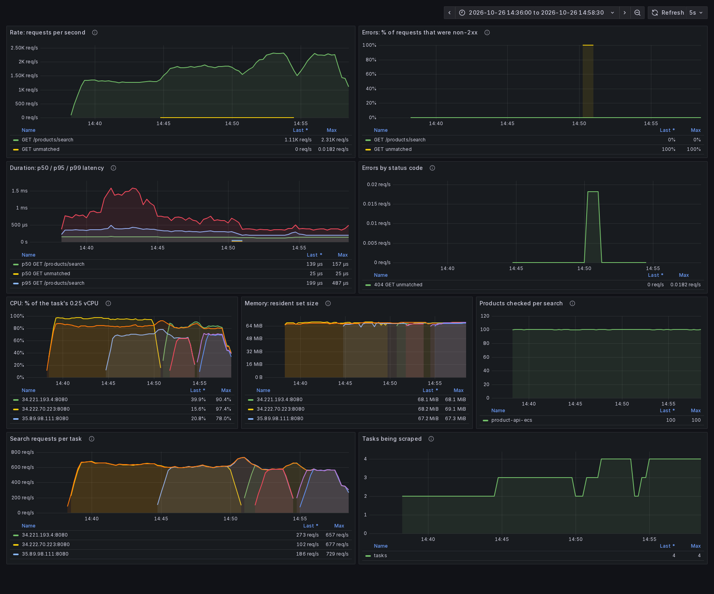

| | Part II (1 task) | Part III, 2 tasks (first 6 min) | 3 tasks | 4 tasks |
|---|---|---|---|---|
| Throughput | 1,065 req/s | ~1,330 req/s | ~1,820 req/s | ~2,300 req/s |
| p50 | 1 ms | 1–2 ms | 1–2 ms | 1–2 ms |
| p95 | 66 ms | 50–54 ms | 24–28 ms | **1–2 ms** |
| p99 | 87 ms | ~82 ms | 68–76 ms | 51–59 ms |
| Service CPU (avg) | ~99% | ~91% | ~83% | 70–77% |
| Failures | 0 | 0 | 0 | 0 |

Part III latencies are the ALB's `TargetResponseTime` per minute; Part II's are Locust's. The first 3 minutes are exactly the Part II test, now on 2 tasks.

**Timeline (UTC), from [`timeline.csv`](results/part3/data/timeline.csv) and [`events.txt`](results/part3/data/events.txt):**

| Time | What happened |
|---|---|
| 14:37:32 | 20 users start. 2 tasks at ~91% CPU; p95 ~52 ms |
| 14:43:36 | `AlarmHigh` (3 datapoints > 70%) → **desired 2 → 3**, ~6 min after load began |
| 14:44:36 | New task passes 2 health checks → 3 healthy targets (~60 s after the decision) |
| 14:49:32 | **Resilience: stopped 1 of 3 tasks.** Target group shows it `draining`; ECS starts a replacement immediately |
| 14:50:32 | Replacement healthy, back to 3 (~60 s) |
| 14:50:36 | Cooldown over, CPU still > 70% → **desired 3 → 4** |
| 14:51:21 | 4 healthy targets; p95 drops to 1–2 ms |
| 14:53:34 | **Stopped 2 of 4 tasks at once.** The 2 survivors carry ~1,300 req/s; ECS replaces both |
| 14:54:43 | 4 healthy again (~70 s). The only visible effect was one minute of p95 at 12 ms |
| 14:57:35 | Test ends with 0 failures |

### 1. How horizontal scaling solved the Part II bottleneck

Part II's bottleneck was CPU: one 0.25 vCPU task maxes out at ~1,100 req/s, and beyond that requests queue behind Fargate's CPU throttling (the ~65 ms pauses). Horizontal scaling adds CPU by adding tasks, and the ALB splits requests across them:

- **Load spreads evenly across tasks.** The Grafana *Search requests per task* panel shows each task getting the same share (~650 req/s with 2 tasks, ~600 with 3 or 4).
- **Capacity adds up.** Throughput went 1,330 → 1,820 → 2,300 req/s as tasks went 2 → 3 → 4, roughly +500 req/s per task, until the 20 users' demand was met.
- **Latency recovered.** p95 fell from 66 ms (Part II) to 1–2 ms once there was spare CPU, because requests no longer wait for throttled CPU.
- **Each task does the same work as before.** In-handler latency stayed under ~1.5 ms and products checked stayed at exactly 100 per search. The service got more CPU, not faster code.
- **Per-task CPU is not perfectly equal, even with equal requests.** With 3 tasks each serving ~600 req/s, CPU read ~97%, ~85% and ~70% (CloudWatch per-task CPU and Grafana). The tasks run on different underlying hosts, so a fixed number of requests costs different amounts of CPU. Target tracking uses the *average*, so the hottest task can still be throttled while the service is "at target".

### 2. Role of each component

| Component | Role here |
|---|---|
| **Application Load Balancer** | One stable entry point (`CS6650-search-alb-….elb.amazonaws.com`, port 80) in front of a changing set of tasks. Spreads requests across healthy targets (round robin), stops sending to a target that fails health checks, and reports request count, target response time and 5XX errors to CloudWatch. Clients no longer need a task's IP, which changed on every restart in Part II. |
| **Target group** | The list of tasks the ALB may send to, registered **by IP** (Fargate tasks have no instance ID) on HTTP port 8080. It health-checks every target with `GET /health` every 30 s, and a target takes 2 consecutive passes to become healthy. ECS registers new tasks and deregisters stopped ones automatically. Deregistration lets in-flight requests finish (30 s here). |
| **Auto scaling (Application Auto Scaling, target tracking)** | Watches the service's average `CPUUtilization` and changes the ECS service's **desired count** (min 2, max 4) to hold it at 70%. It creates two CloudWatch alarms: *AlarmHigh* (3 × 1-min datapoints above 70%) scales out, *AlarmLow* (15 × 1-min below ~63%) scales in. Cooldowns (300 s) stop it reacting to its own last change. |
| **ECS service** | Turns the desired count into running Fargate tasks, replaces tasks that stop or fail ALB health checks, and wires each task into the target group. |

### 3. Horizontal vs. vertical scaling

| | Horizontal (this setup: more 0.25 vCPU tasks) | Vertical (one bigger task, e.g. 1 vCPU) |
|---|---|---|
| Ceiling | Max tasks × ~1,100 req/s, raised by changing one number | The largest Fargate size (16 vCPU); one process must also use all those cores |
| Failure | Losing one task removes 1/N of capacity; the ALB routes around it | Losing the task is a full outage until a replacement starts |
| Change without downtime | Yes: tasks are added and removed under load | No: a new task size means replacing the task |
| Speed of scaling | Minutes (alarm + task start + 2 health checks) | Minutes, plus a restart |
| Extra parts and cost | ALB (~$0.02/h plus usage), health checks, state must not live in one task | Nothing extra; simplest to run and reason about |
| Fit for this service | Excellent: every task generates the same 100,000 products, so any task can answer any search | Fine until one machine isn't enough or a single failure is unacceptable |

**Caveat this service exposes:** products created with `POST /products/{id}/details` live in one task's memory. Behind the ALB, a later `GET` can land on another task and return 404. Horizontal scaling assumes stateless instances, so the write path would need a shared store (DynamoDB, Redis) first. The search path is already stateless.

### 4. Predicted scaling behaviour for different load patterns

Predictions from what the Part II step test and this core test measured. A task handles ~1,100 req/s at 100% CPU (~770 at 70%), each user sends ~100–150 req/s, scale-out needs 3 one-minute datapoints above target, and a new task takes ~50–60 s to start and pass 2 health checks.

| Load pattern | Predicted behaviour |
|---|---|
| **Sudden heavy load** (the core test: 20 users at once) | Measured: ~6 min of degraded p95/p99 before the first new task, then one task per cooldown (300 s), so reaching 4 tasks takes ~13 min. The cooldown, not detection, sets the pace. |
| **Gradual ramp** | Scaling keeps up: CPU crosses 70% while there is still headroom below 100%, so new tasks arrive before latency degrades much. Steps happen roughly every time load grows by ~770 req/s. |
| **Spike from quiet** (2 → 40 users) | The worst case: the 2 minimum tasks saturate immediately, and it takes ~5–6 min for the first new task and ~11 min to reach max 4. At 40 users even 4 tasks are short (40 × ~130 ≈ 5,200 req/s vs ~4,400), so CPU stays pinned and latency stays high at max capacity. Fixes: a higher minimum, step scaling for big jumps, or a higher max. |
| **Short bursts (< 3 min)** | No scaling at all: the alarm needs 3 consecutive minutes above target. Only the minimum capacity matters. |
| **Load drops** | Scale-in is deliberately slow: 15 min below ~63% CPU, then one task per 300 s cooldown, never below 2. |
| **Policy changes** | A **50% target** scales out sooner and runs more tasks (lower latency, more cost); **90%** waits until tasks are nearly saturated, which on 0.25 vCPU means the CPU-throttling latency (~65 ms) is already showing. **Shorter cooldowns** reach max capacity faster under heavy load but risk overshooting; **min 3–4** absorbs spikes without waiting. |

### 5. CPU vs. a request metric as the scaling trigger

What the two dashboards showed during the scale-out:

- **CPU (CloudWatch):** above 70% from the first full minute (14:38, 92%). The scale-out came at 14:43:36: 3 one-minute datapoints, plus ~2–3 min of CloudWatch publishing delay.
- **User-facing latency (ALB `TargetResponseTime`, Locust):** p95 was already ~52 ms in the first minute too. It's flat until a task saturates and then jumps (Part II step test: 1 ms up to 5 users, 30–70 ms after), so it says "already saturated" rather than "getting close".
- **In-handler duration (HW5 Grafana):** p99 only moved from ~0.4 ms to ~1.5 ms. The time is spent *waiting* for CPU, outside the handler, so a trigger on app-level request duration would **never** have fired.
- **Requests per target (Grafana per-task panel, ALB `RequestCountPerTarget`):** ~650 req/s per task from the first minute, steady and proportional to CPU, because every search costs the same.

**Sooner or later?** A latency or request-count trigger would not have scaled meaningfully *sooner*. All three CloudWatch signals crossed their thresholds in the same first minute, and the delay comes from the alarm mechanics (3 datapoints, publishing lag, cooldown), not the metric. A trigger on in-handler duration would have been *later*: never.

**My pick for this workload: CPU, or equivalently `ALBRequestCountPerTarget`.** This is fixed-cost CPU-bound work, so CPU measures the actual bottleneck, and request count per target is a linear proxy for it (~770 req/s per task ≈ 70% CPU). Request count has two advantages: it doesn't vary with which Fargate host a task lands on (CPU did: 70–97% for equal requests), and it predicts saturation before latency moves. Latency stays as an SLO alarm rather than the scaling trigger: it reacts only after users are hurt, and it would also fire for causes more tasks don't fix (network, a slow dependency).

### 6. Resilience and creative stress testing (exploration)

| Experiment | What I did | What happened |
|---|---|---|
| **Stop one task under load** (the assignment's resilience test) | 14:49:32, stopped 1 of 3 tasks with `aws ecs stop-task` (same as **Stop** in the console) | Target group marked it `draining` within ~15 s; the ALB stopped routing to it. ECS started a replacement right away, which was healthy ~60 s later. **0 failed requests**; p95/p99 barely moved. |
| **Stop several tasks at once** | 14:53:34, stopped 2 of 4 tasks together | Throughput dipped to what 2 tasks can serve (~1,300 req/s) for ~1 min while ECS replaced both; 4 healthy again after ~70 s. **0 failed requests**; one minute of p95 at 12 ms. |
| **Make every task fail its health check** | 14:59:23, pointed the health check at `/does-not-exist` under the same 20-user load; restored `/health` at 15:03:23 | ~90 s later **all 4 targets were unhealthy, yet the ALB kept returning 200**: when no target is healthy, an ALB *fails open* and routes to all of them. ECS treated the unhealthy tasks as failed and **replaced them over and over**: it started new tasks first (up to 8 running), then stopped the old ones, and the new ones failed the same broken check. After the fix, targets were healthy within ~40 s and the extra tasks drained. **866,930 requests, 0 failures, no ALB 5XX.** Lesson: a bad health check doesn't cause an outage here, but it causes constant task churn, and with a genuinely broken app, failing open would send users to broken tasks. |
| **Extended duration** | Held the Part II load for 20 min instead of 3 | Needed to see scaling at all: the first scale-out came at minute 6 and max capacity at minute 14. A 3-minute test ends before any scaling happens. |
| **Load generator inside AWS** (from Part II) | Locust on EC2 in the same region (2 processes) | Keeps the load generator from being the bottleneck: it sustained ~2,300 req/s through the ALB with 2 ms medians. |

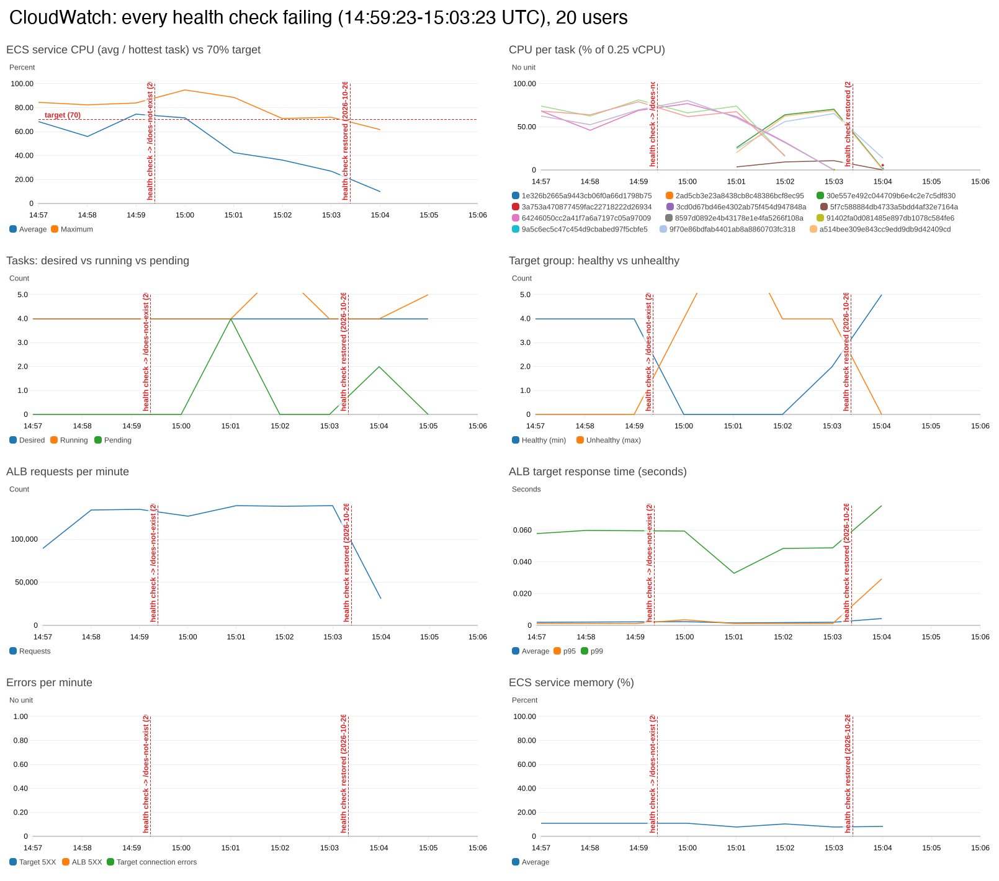

<details>
<summary>Locust report for the core test</summary>

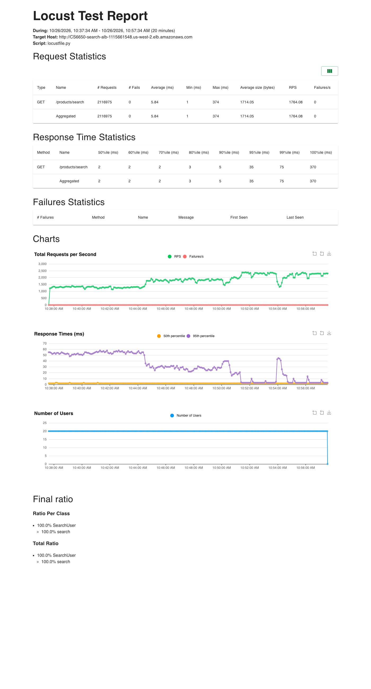

</details>

**Not run (time):** the 50% / 90% CPU targets, different min/max and cooldowns, and the ramp and spike load shapes. The shapes are ready in `locust/ramp_locustfile.py` and `locust/spike_locustfile.py`, and the policy values are Terraform variables (`terraform apply -var cpu_target=50 -var scale_out_cooldown=60`). Section 4 gives the predicted behaviour for each, based on the measured numbers.

**Takeaway:** the service now handles the load that broke it in Part II, with 0 errors and p95 back to 1–2 ms at 4 tasks, and it survives losing half its tasks mid-test. Adding identical stateless instances behind a load balancer, with health checks and auto scaling deciding how many, is how most modern distributed services handle both growth and failure.

---

## Where everything is

```
.
├── src/product-service.go      # handlers (incl. /products/search), product generation, metrics, JSON logs
├── terraform/                  # ECR, ECS (0.25 vCPU / 512 MB), ALB + target group, auto scaling, CloudWatch dashboard
├── loadgen/                    # launch.sh / run.sh / teardown.sh: Locust on EC2 in us-west-2 via Systems Manager
├── locust/
│   ├── search_locustfile.py    # Tests 1 and 2: FastHttpUser searching common terms
│   ├── step_locustfile.py      # Test 3: step load 1 → 40 users
│   ├── ramp_locustfile.py      # Part III exploration: 1 → 30 users over 15 min
│   ├── spike_locustfile.py     # Part III exploration: 2 → 40 users at once
│   └── locustfile.py           # HW5 GET/POST mix for the other two endpoints
├── observability/              # Prometheus + Grafana (+ image renderer), HW5 dashboard with CPU/memory/products-checked panels
├── postman/                    # HW5 collection for the other two endpoints
└── results/                    # Part II screenshots and data; results/part3/ for Part III
```

## Deploy

You need Terraform, the AWS CLI, Docker Desktop and an AWS Academy Learner Lab session (the Terraform reuses the lab's `LabRole`).

1. **Credentials:** in Learner Lab, open **AWS Details → AWS CLI: Show** and paste the block into `~/.aws/credentials`. Then run `aws configure set region us-west-2` and check with `aws sts get-caller-identity`. Credentials expire with the lab session (~4 h). Never commit them.
2. **Docker:** start Docker Desktop. On macOS, in the terminal you'll run Terraform from:
   ```bash
   export DOCKER_HOST=unix://$HOME/.docker/run/docker.sock
   ```
3. **Deploy:**
   ```bash
   cd terraform
   terraform init
   terraform apply        # Plan: 16 to add. Type yes
   ```
   This creates the ECR repo `ecr_search_service`, the cluster `CS6650-search-cluster` (Container Insights on), the service `CS6650-search` with 2 tasks, the ALB `CS6650-search-alb` and target group, the CPU target-tracking policy, the CloudWatch dashboard `CS6650-search-scaling` and the log group `/ecs/CS6650-search`. Scaling settings are variables: `terraform apply -var cpu_target=50 -var min_tasks=2 -var max_tasks=4 -var scale_out_cooldown=300 -var scale_in_cooldown=300`.
   ```bash
   terraform output alb_dns_name     # send traffic to http://<this>/products/search?q=...
   terraform output dashboard_url    # CloudWatch dashboard
   ```
4. **Get the task's IPs** (wait about a minute after the apply):
   ```bash
   TASK=$(aws ecs list-tasks --cluster CS6650-search-cluster --service-name CS6650-search --query 'taskArns[0]' --output text)
   ENI=$(aws ecs describe-tasks --cluster CS6650-search-cluster --tasks $TASK --query "tasks[0].attachments[0].details[?name=='networkInterfaceId'].value" --output text)
   IP=$(aws ec2 describe-network-interfaces --network-interface-ids $ENI --query 'NetworkInterfaces[0].Association.PublicIp' --output text)
   PRIVATE_IP=$(aws ec2 describe-network-interfaces --network-interface-ids $ENI --query 'NetworkInterfaces[0].PrivateIpAddress' --output text)
   echo "public: http://$IP:8080   private (from inside the VPC): http://$PRIVATE_IP:8080"
   ```

**Deploying code changes:** `terraform apply -replace=docker_image.app -replace=docker_registry_image.app`, then `aws ecs update-service --cluster CS6650-search-cluster --service CS6650-search --force-new-deployment`. The new task gets a new IP.

## Search requests

```bash
curl -s "http://$IP:8080/products/search?q=electro"
```
```json
{"products":[{"product_id":110,"name":"Product Beta 110","sku":"SKU-000110","manufacturer":"Beta Corporation","category_id":1,"weight":110,"some_other_id":111}, ...],"total_found":10,"search_time":"96.196µs"}
```

| Request | Response |
|---|---|
| `?q=electro`, `?q=BOOKS`, `?q=alpha` | `200`. Matches in name or category, case-insensitive, at most 20 |
| `?q=zzz` | `200` with `"products":[]`, `"total_found":0` |
| no `q`, or `?q=` | `400` `INVALID_INPUT` (`query parameter q is required`) |
| `q` longer than 100 characters | `400` `INVALID_INPUT` |

Each search checks the next 100 products of the catalog (the starting point rotates), so repeating a query returns different products. `search_time` is time spent in the handler. `total_found` is the number of products returned, capped at 20 per the spec.

## Run the load tests

**Part III (through the ALB, from EC2):**

```bash
loadgen/launch.sh        # t3.medium with Locust, driven by Systems Manager (no SSH)
loadgen/run.sh core locust/search_locustfile.py -u 20 -r 20 -t 20m --processes 2 --host http://$(terraform -chdir=terraform output -raw alb_dns_name)
loadgen/teardown.sh
```

Results land in `results/part3/data/<name>/`.

**Part II (single task):**

From the repo, against the public IP (`pip install locust`):

```bash
cd locust
locust -f search_locustfile.py --headless -u 5  -r 5  -t 2m --host http://$IP:8080 --csv test1_5u  --html test1_5u.html
locust -f search_locustfile.py --headless -u 20 -r 20 -t 3m --host http://$IP:8080 --csv test2_20u --html test2_20u.html
locust -f step_locustfile.py   --headless --host http://$IP:8080 --csv test3_step --html test3_step.html
```

**Run Locust inside AWS to load the server rather than your network.** From a laptop, each request pays the ~90 ms round trip, so 20 users can't push the task past ~20% CPU. For the results above, Locust ran on an EC2 `t3.medium` in us-west-2 (Amazon Linux 2023 with Python 3.11: `python3.11 -m venv venv && venv/bin/pip install locust`) against `http://$PRIVATE_IP:8080`. If your network blocks SSH, attach the `LabInstanceProfile` instance role and run commands through **Systems Manager → Run Command** or Session Manager.

## Observability

**Grafana + Prometheus against the ECS task.** Prometheus runs on your machine and scrapes the task's public IP:

```bash
cd observability
mkdir -p targets && echo "[{\"targets\": [\"$IP:8080\"]}]" > targets/ecs.json
docker compose up -d --no-deps prometheus grafana renderer
```

To follow every task while the service scales, run `./ecs-targets.sh` in another terminal. It rewrites `targets/ecs.json` with all running tasks' IPs every 15 s.

Open http://localhost:3000. The **Product API: RED signals** dashboard has rate, errors, latency, plus CPU (% of 0.25 vCPU), memory, and products checked per search. Export a PNG of any time range with:

```bash
curl -o dashboard.png "http://localhost:3000/render/d/product-api-red/?orgId=1&from=now-15m&to=now&width=1800&height=1150&kiosk"
```

`docker compose up --build -d` (without `--no-deps`) still runs the whole stack against a local copy of the API, as in HW5.

**CloudWatch:** ECS console → `CS6650-search-cluster` → `CS6650-search` → **Metrics** for CPU and memory, and `/ecs/CS6650-search` in CloudWatch Logs for request logs. To render the console's CPU graph to a PNG from the CLI:

```bash
aws cloudwatch get-metric-widget-image --output text --query MetricWidgetImage --metric-widget '{
  "metrics":[["AWS/ECS","CPUUtilization","ClusterName","CS6650-search-cluster","ServiceName","CS6650-search"]],
  "start":"-PT15M","period":60,"yAxis":{"left":{"min":0,"max":100}}}' | base64 -d > cpu.png
```

**Scaling alarm** (as used in the report):

```bash
aws cloudwatch put-metric-alarm --alarm-name CS6650-search-cpu-high \
  --namespace AWS/ECS --metric-name CPUUtilization \
  --dimensions Name=ClusterName,Value=CS6650-search-cluster Name=ServiceName,Value=CS6650-search \
  --statistic Average --period 60 --evaluation-periods 1 --threshold 70 \
  --comparison-operator GreaterThanThreshold --treat-missing-data notBreaching
```

## Clean up

```bash
cd terraform && terraform destroy
loadgen/teardown.sh    # if you launched the load generator
cd ../observability && docker compose down
```

If you launched an EC2 load generator, terminate it too.

## Troubleshooting

| Problem | Fix |
|---|---|
| `ExpiredToken` | The lab session ended. Paste the new credentials into `~/.aws/credentials`. |
| `Cannot connect to the Docker daemon at unix:///var/run/docker.sock` | Start Docker Desktop and `export DOCKER_HOST=unix://$HOME/.docker/run/docker.sock`. |
| `curl` times out | The task restarted with a new IP. Redo step 4 of [Deploy](#deploy). |
| CPU stays low under load | Check Grafana's *Products checked per search* (should be 100). If it is, the load generator is the limit: run Locust from EC2 in the same region. |
| `pip install locust` fails building `gevent` on Amazon Linux | Its default Python 3.9 `pip` is too old. Use `python3.11` in a venv. |
| Prometheus target `product-api` is down | Expected when only scraping ECS. That job is the local copy of the API. |
